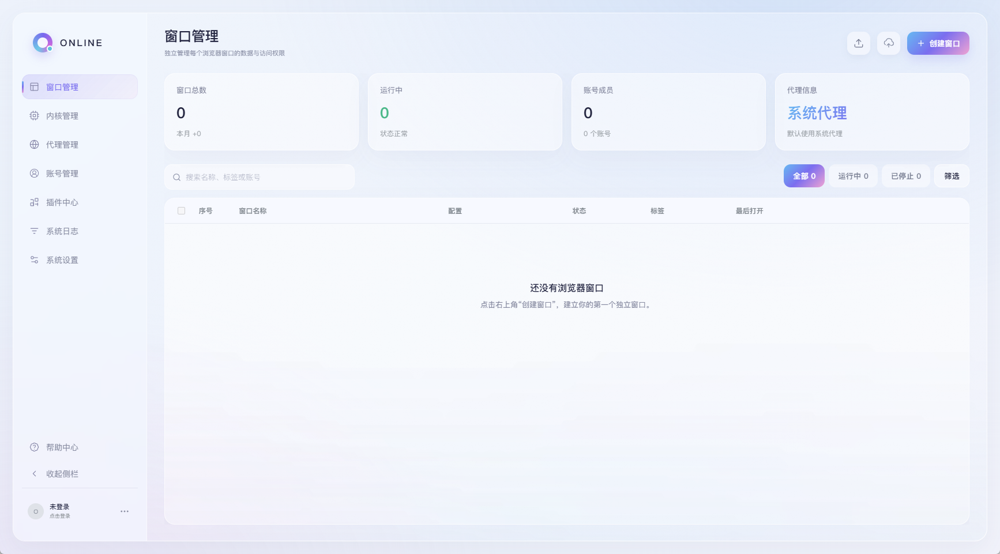
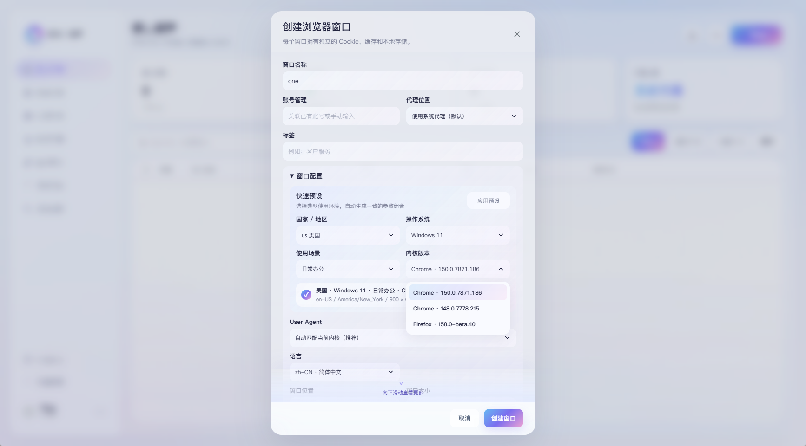
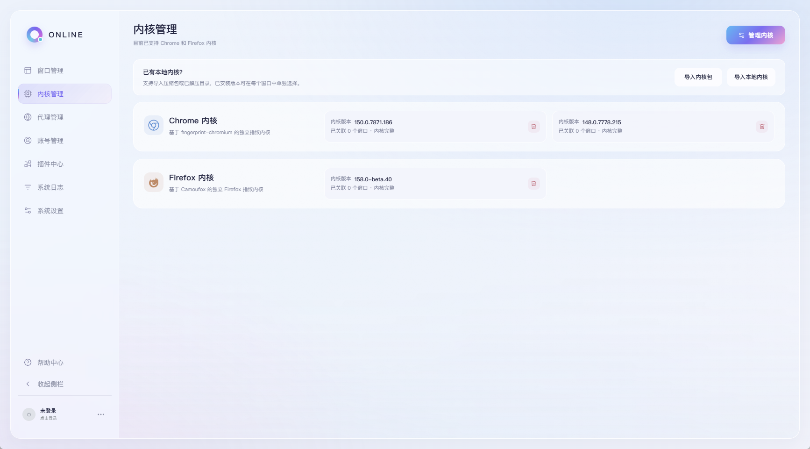
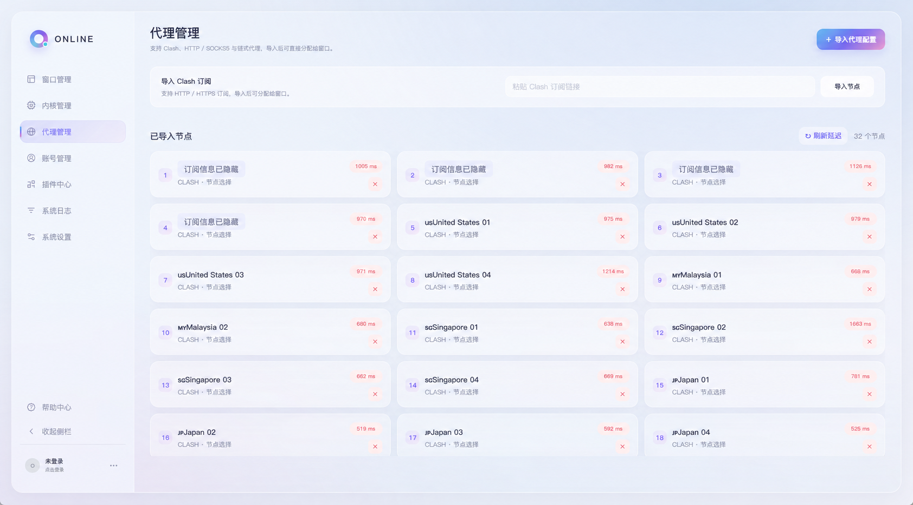
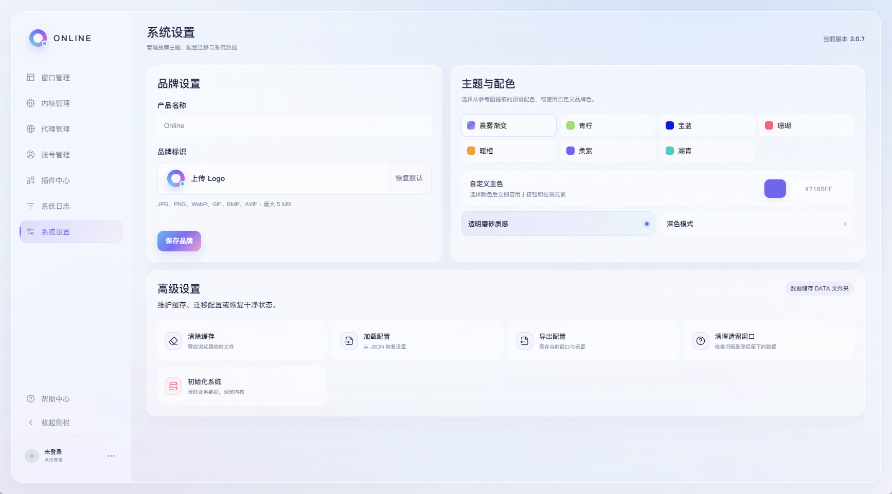
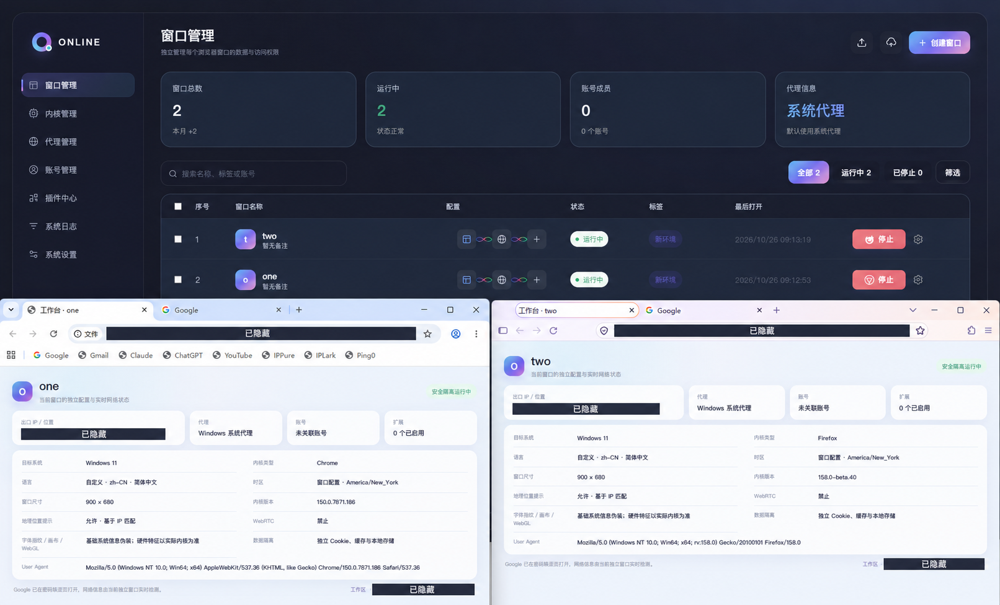

<div align="center">

# One Browser

**独立窗口 · 本地数据 · 多账号管理**

面向 Windows x64 的本地指纹浏览器管理工具，将浏览器窗口、内核、代理、账号和插件集中在一个界面中。

[下载客户端](https://github.com/onefom/ONE-Browser/releases) · [反馈问题](https://github.com/onefom/ONE-Browser/issues) · [版本说明](./GITHUB-RELEASE-2.0.7.md)

</div>

---

## 项目简介

One Browser 为不同业务、账号或使用场景建立独立的浏览器环境。每个窗口使用自己的数据目录，保存 Cookie、登录状态、标签页和本地存储，方便关闭后继续使用。

支持 **Chrome 与 Firefox 两类内核**，可同时保留多个版本，并为每个窗口选择需要的内核。客户端提供 Windows x64 便携版，解压后即可使用；浏览器内核首次使用时另行下载或导入。

> 当前仓库代码版本：**2.0.7**。可下载的客户端版本以 [Releases](https://github.com/onefom/ONE-Browser/releases) 页面为准。

## 主要功能

| 模块 | 功能 |
| --- | --- |
| 窗口管理 | 创建、编辑、复制、启动、停止和重启窗口；查看运行状态与关联配置。 |
| 独立数据 | 每个窗口使用独立的 Cookie、缓存和本地存储；正常关闭后保留会话数据。 |
| 内核管理 | 分别管理 Chrome / Firefox，支持在线下载、本地导入、多版本共存与窗口版本选择。 |
| 代理管理 | 默认使用系统代理，支持导入 Clash 订阅及代理配置、选择节点和测试延迟。 |
| IP 变化提醒 | 对使用系统代理的运行窗口检测出口 IPv4 变化，显示变更前后的 IP、地区与受影响窗口。 |
| 账号管理 | 集中维护本机账号资料、关联窗口，支持导入与导出。 |
| 插件中心 | 按窗口选择加载内置或导入的 Chrome 插件，支持单独或批量关联。 |
| 界面设置 | 浅色 / 深色模式、可选磨砂质感、自定义主色、品牌名称与圆形 Logo 裁切。 |
| 日志与维护 | 查看、导出和清理日志，提供缓存清理、配置导入导出及本地数据维护。 |

## 界面预览

<table>
  <tr>
    <td width="50%" align="center">
      <strong>窗口管理 · 浅色</strong><br>
      <sub>独立窗口与运行状态</sub><br><br>
      <a href="docs/screenshots/01-windows-light.png"></a>
    </td>
    <td width="50%" align="center">
      <strong>创建窗口</strong><br>
      <sub>选择代理、系统参数与内核版本</sub><br><br>
      <a href="docs/screenshots/02-create-window.png"></a>
    </td>
  </tr>
  <tr>
    <td width="50%" align="center">
      <strong>内核管理</strong><br>
      <sub>Chrome / Firefox 分别管理，多版本共存</sub><br><br>
      <a href="docs/screenshots/03-kernels.png"></a>
    </td>
    <td width="50%" align="center">
      <strong>代理管理</strong><br>
      <sub>订阅导入、节点选择与延迟查看</sub><br><br>
      <a href="docs/screenshots/04-proxies.png"></a>
    </td>
  </tr>
  <tr>
    <td width="50%" align="center">
      <strong>系统设置</strong><br>
      <sub>品牌标识、主题配色与本地数据维护</sub><br><br>
      <a href="docs/screenshots/05-settings.png"></a>
    </td>
    <td width="50%" align="center">
      <strong>双内核运行 · 深色</strong><br>
      <sub>Chrome 与 Firefox 同时运行</sub><br><br>
      <a href="docs/screenshots/06-dual-kernel-dark.png"></a>
    </td>
  </tr>
</table>

点击图片可查看大图。截图中的出口 IP、本地路径、工作区标识及订阅信息已隐藏。


## 快速开始

1. 在 [Releases](https://github.com/onefom/ONE-Browser/releases) 下载 Windows x64 完整版，并解压到有写入权限的目录。
2. 运行 `OneBrowser.exe`。如提示缺少 WebView2，请先安装 Microsoft Edge WebView2 Runtime。
3. 进入「内核管理」，下载 Chrome / Firefox 内核，或导入已有的 Windows x64 内核包、已解压目录。
4. 点击「创建窗口」，设置名称、代理与内核版本；需要时关联账号并调整窗口配置。
5. 启动窗口。首次使用打开工作台与 Google，已有会话时恢复上次网页。

客户端只提供 **完整版与源码**。GitHub 自动生成的 Source code 压缩包用于开发，运行程序请下载发布页面附带的 Windows x64 便携包。

## 使用说明

### 内核与窗口

- Chrome 基于 [fingerprint-chromium](https://github.com/adryfish/fingerprint-chromium)，Firefox 基于 [Camoufox](https://github.com/daijro/camoufox)。
- 两类内核分别管理，各自按版本从新到旧排列；新建和编辑窗口中的版本列表保持一致。
- 安装新内核后，已有窗口仍保留原来的版本选择。切换版本请通过窗口齿轮菜单 →「编辑窗口」操作。
- 内核仍被窗口关联时禁止删除；更换关联版本后才可移除。外部导入目录仅取消关联，不删除外部文件。
- 正在运行的窗口不能删除。关闭后删除窗口，会同时删除它对应的数据目录。
- Chrome 与 Firefox 的窗口数据分开保存，切换两类内核时不会自动迁移登录状态。

### 插件

内置 AdGuard、篡改猴与 Google 翻译默认不加载。点击插件卡片右侧的圆点，选择需要关联的窗口后保存；导入的插件同样需要选择窗口。

运行中的窗口默认在下次启动时应用插件变更，也可按提示选择重启。插件中心管理的 Chrome 插件不适用于 Firefox；Firefox 扩展请在其浏览器中安装。

### IP 变化提醒

使用系统代理的运行窗口，每 **60 秒**检查一次出口 IPv4；同一路由共享检测。确认变化后，弹窗展示旧 IP、新 IP、地区及受影响窗口，由用户选择继续使用或关闭相关窗口。

独立代理窗口不参与这项检测。首次检测只建立基准；网络超时或查询失败时可能延后提醒，因此它不提供实时断网保护。

## 数据保存与升级

账号、窗口配置、界面设置、日志及浏览器窗口数据保存在程序旁的 `data` 目录。内核和运行组件还可能位于 `chrome`、`bin` 等目录。

**升级前请退出全部浏览器窗口和托盘程序，并备份原程序目录。**

升级时替换新版程序和 `OneBrowser.ico`，保留原来的：

- `data`
- `chrome`
- `bin`
- `config.yaml`

迁移到其他位置时，建议在程序完全退出后复制整个便携目录。配置导出用于保存设置，不代替包含 Cookie、密码和网页会话的完整浏览器数据备份。

上传代码或截图前，请隐藏真实账号、密码、订阅地址、代理凭据和个人网页信息。账号导出文件未加密，请妥善保存。

## 2.0.7 更新

- 新建、编辑窗口的内核下拉列表统一从新到旧排序。
- 内核管理卡片及管理面板的版本列表使用相同排序规则，例如 **150 → 148 → 144**。
- Chrome / Firefox 独立分组，排序不会更改已有窗口绑定的内核。
- 保留此前的深色模式、资源加载与空列表接缝修复。

完整说明见 [GITHUB-RELEASE-2.0.7.md](./GITHUB-RELEASE-2.0.7.md)。

## 开发与构建

项目使用 **Go + Wails v2 + React + TypeScript + Vite**。请先准备 Go、Node.js / npm、Windows 构建工具及 WebView2 Runtime；依赖以仓库配置为准。

```powershell
git clone https://github.com/onefom/ONE-Browser.git
cd ONE-Browser

go install github.com/wailsapp/wails/v2/cmd/wails@v2.12.0
go mod download
npm --prefix frontend install

# 开发运行
wails dev

# 构建 Windows x64
wails build -platform windows/amd64 -clean -o OneBrowser.exe

# 校验 EXE 中的 Windows 启动资源
python tools/verify-windows-resources.py build/bin/OneBrowser.exe
```

生成的程序位于 `build/bin/OneBrowser.exe`。

基础检查：

```powershell
npm --prefix frontend run test:one-browser
go test ./backend/internal/browser ./backend
```

构建与上传说明见 [GITHUB-UPLOAD.md](./GITHUB-UPLOAD.md)，验证范围见 [TESTING-STATUS.md](./TESTING-STATUS.md)。

## 问题反馈

请通过 [GitHub Issues](https://github.com/onefom/ONE-Browser/issues) 描述问题，并尽量提供客户端版本、内核类型与版本、复现步骤、截图及相关日志。提交前请移除敏感信息。

感谢 [Wails](https://github.com/wailsapp/wails)、[fingerprint-chromium](https://github.com/adryfish/fingerprint-chromium) 与 [Camoufox](https://github.com/daijro/camoufox) 等项目。

